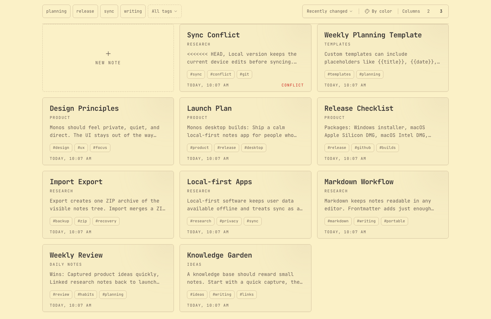
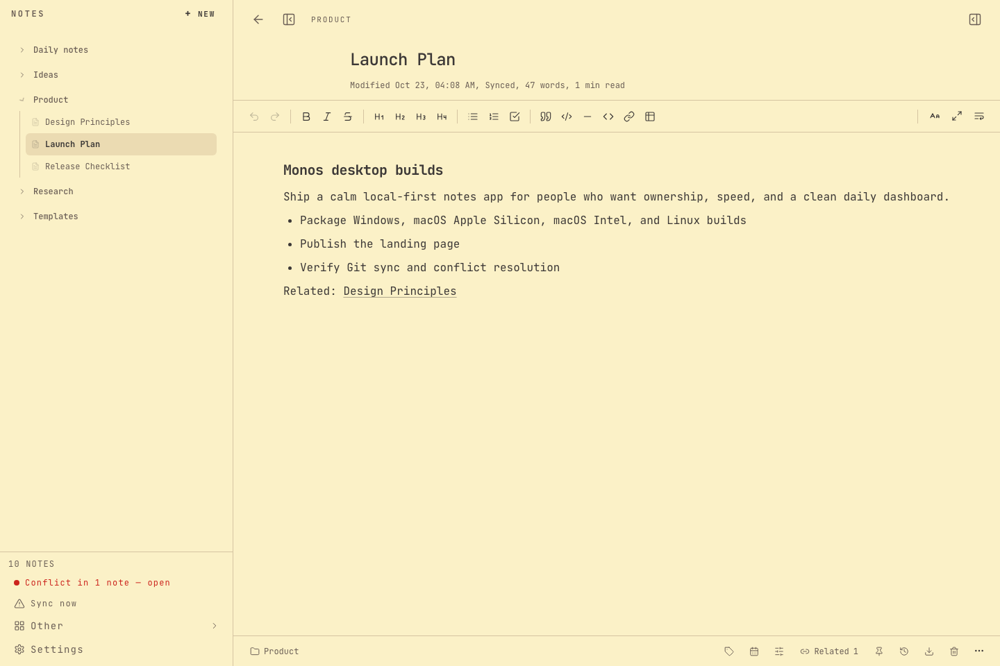
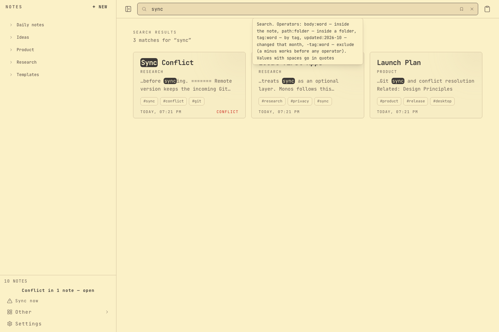
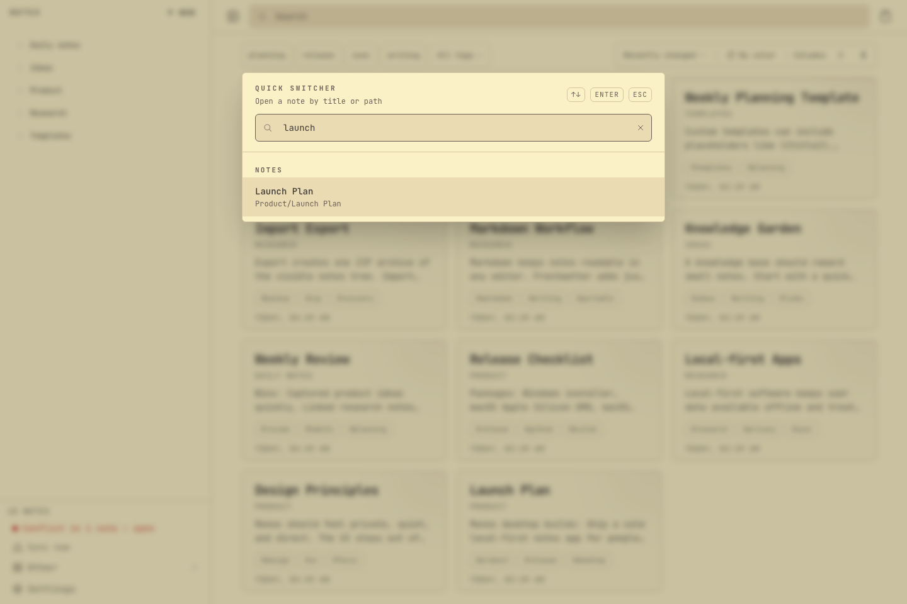
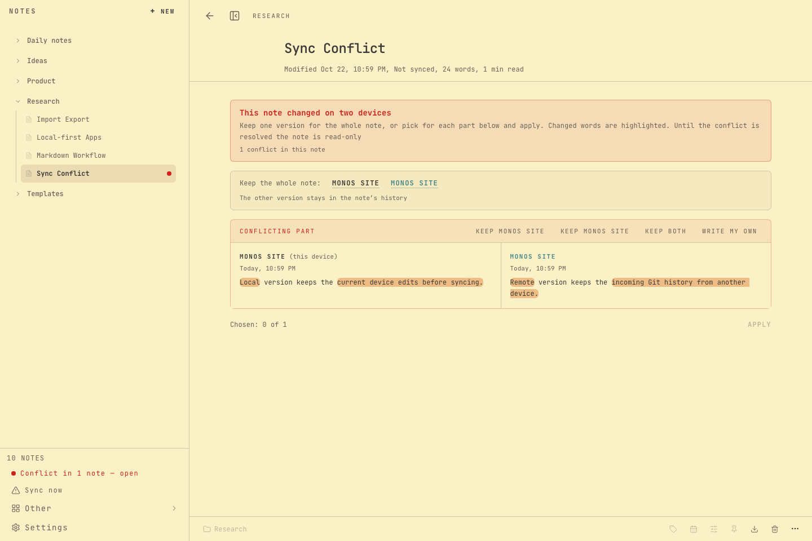
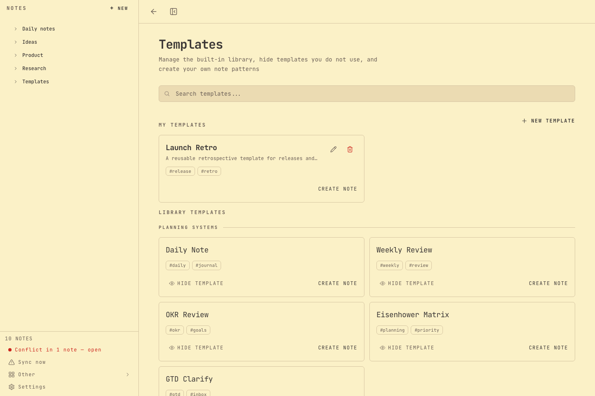
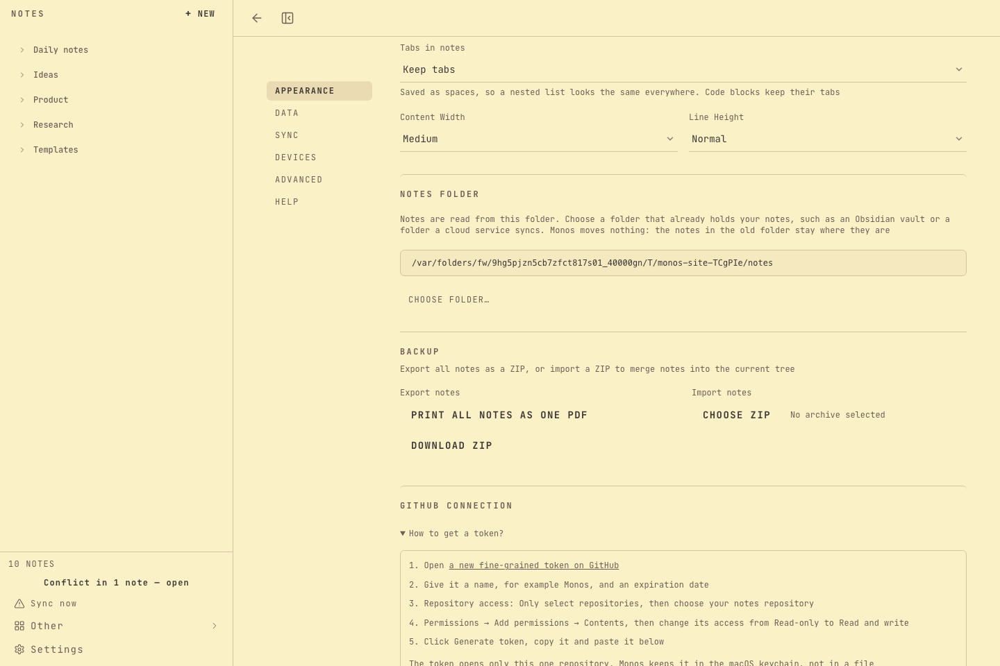
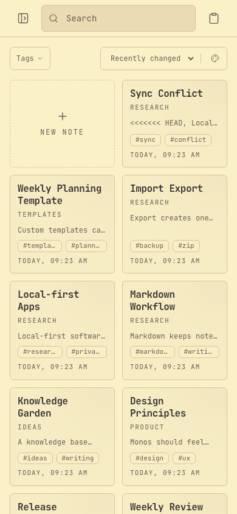

# Monos

Monos is a desktop notes app that keeps every note as a plain Markdown file on your own computer. It links notes with `[[wiki links]]`, searches across titles, tags and bodies, and can sync them between your devices through your own Git repository. There is no account and no service in the middle: the folder of files is the product, and the index beside it can be deleted at any moment.



[](LICENSE)
[](https://github.com/aa-blinov/monos/actions/workflows/desktop-build.yml)

---

## Quick start

Download the installer for your system from the [latest release](https://github.com/aa-blinov/monos/releases/latest).

| Platform | Artefact | First launch |
| --- | --- | --- |
| macOS | `.dmg`, Apple silicon and Intel | The app is not notarized, so macOS asks once. |
| Windows | NSIS installer, `.exe` | SmartScreen asks once. |
| Linux | `.AppImage` and `.deb` | Nothing to confirm. |

On macOS, try to open Monos, close the warning, then open System Settings, Privacy and Security, and click **Open Anyway** next to the message about Monos. Confirm with your password and later launches open normally. The same thing from a terminal:

```bash
xattr -dr com.apple.quarantine /Applications/Monos.app
```

On Windows, click **More info** and then **Run anyway**.

The notes stay in the app data folder, and they are kept when a new version is installed over an older one.

## What it does

- **Your notes are files.** Every note is a Markdown file in a folder you choose, and its attachments sit in `_attachments` beside it. The SQLite index next to that folder is a cache, and deleting it costs nothing but a reindex.
- **Wiki links and backlinks.** Type `[[Note title]]` and the link opens the other note, or creates it when it does not exist yet. Every note lists the notes that point back at it.
- **Search that finds the word inside the word.** Titles, tags and bodies go into an SQLite FTS5 index with a trigram tokenizer, so `сеть` finds «подсеть» and `rag` finds «fragment».
- **A board of recent notes.** Cards carry the category, the tags, an excerpt and the date, and can be grouped by colour or shown as a plain list.
- **An editor that writes Markdown.** TipTap with tables, task lists, callouts and embeds, and the file on disk stays plain Markdown.
- **Optional Git sync.** The notes folder itself is the repository. A sync commits, pulls and pushes, and when two devices changed the same note, both versions are shown side by side and you choose the one to keep.
- **A terminal for your own agent.** The panel at the bottom runs a shell in the notes folder of that computer, so Claude Code, Codex, Gemini or any other command works on the notes without leaving the window. The agent's edits are checkpointed before it runs, and each one can be kept or reverted.
- **Access from a phone.** Switch it on in Settings and Monos serves the notes to the network with a token in the link. It is off by default.
- **Export, print and publish.** A ZIP backup of the notes, a PDF of one note or of the whole folder, and a static site export written to a folder you name.
- **A web clipper.** The browser extension posts the page you are reading, or the text you selected, into the notes folder as Markdown. It talks to your own computer and to nothing else.
- **Six palettes and two languages.** Gruvbox, GitHub, Dracula, Nord, Solarized and Catppuccin, each in light and dark; English and Russian, written key for key.

## Screenshots

| The editor | Search results | The quick switcher |
| :---: | :---: | :---: |
|  |  |  |

| Two versions of one note | The template manager | Settings |
| :---: | :---: | :---: |
|  |  |  |

The same board in a narrow window:



## UI stack

The UI is moving onto [`@monos/ui`](https://github.com/aa-blinov/monos-ui). The
kit now owns the palette, the token layer, the Tailwind bridge and the `--ui-*`
semantic roles; Monos keeps its older names as aliases. The Settings actions, the
checkbox, the icon buttons, every search field, the dialog shell and the field
geometry are kit primitives. The note's tag panel is the kit's `TagInput`, and the tree rows are
the kit's `SidebarItem`, and so is the sidebar foot. A note card, the editor and
the rest of the product stay in the app while their primitives move over.


## How it works

```
Electron main process (electron/main.cjs)
  starts the Express backend on 127.0.0.1 and serves the built Svelte app
Svelte frontend (webui/frontend)
  the editor, the board, the search and the settings; @monos/ui supplies
  the token layer and the first migrated primitives; it talks to /api/*
Express backend (webui/backend)
  reads and writes Markdown, keeps the SQLite index, runs git
notes/           Markdown files and their attachments
.data/notes.db   the rebuildable index
```

On startup the Electron main process resolves the operating system's data directory, points the backend at it, starts the backend on a free port and opens a window at that address. In development the two run as separate processes instead: the backend on `http://127.0.0.1:8000` and the Vite dev server on `http://localhost:5173`, which forwards `/api/*` to the backend.

The backend owns the filesystem. It checks every path against the notes root before it touches it, writes Markdown through the same functions the editor uses, and keeps `notes.db` as an index over the folder. A route that is asked for something slow reads only the columns it shows.

The frontend never opens a file. It calls the API, and the backend announces changes over `GET /api/events`, so a note touched by the agent in the terminal, by another editor on the same disk or by a `git pull` appears in the open window without a reload.

The terminal is the one part that does not go through the API. It lives in the Electron main process under node-pty, and the page reaches it through the preload bridge in `electron/preload.cjs`. The backend has no terminal route, so a browser or a phone that opened the notes over the network cannot start a shell.

Git sync runs against the notes folder itself, so only the Markdown and the attachments enter the history and the index never does. A sync commits before it pulls, because git refuses to pull into local changes that have not been committed, which is exactly the state two devices leave the folder in.

## Configuration

| Option | Default | What it does |
| --- | --- | --- |
| Notes folder | `notes/` in the app data directory | Where the files live. A folder you choose can be an Obsidian vault, or one a cloud service already syncs. |
| Palette | `gruvbox` | One of gruvbox, github, dracula, nord, solarized, catppuccin. |
| Theme mode | `system` | `light`, `dark` or `system`. |
| Interface font | JetBrains Mono | The list also holds twelve other families, including the system font. Only JetBrains Mono ships with the app, the rest fall back to what the system has. |
| Interface size | 16px | 14, 16, 18 or 20. |
| Editor size | 16px | 13, 14, 16, 18 or 20. |
| Sync interval | 15 minutes | How often a round runs while the app is open. |
| Upload during a round | on | Each round commits and pushes what this device changed. |
| Upload when the app closes | off | The app asks GitHub before it quits and waits up to 20 seconds. |
| Device name | the name of the computer | Asked on first launch, and it names this device in the commit messages. |
| Agent command | `claude` | The command the terminal starts. The presets are Claude Code, Codex, Gemini, OpenCode and Cursor CLI, and any other command can be typed in. |
| Access from other devices | off | Serves the notes to the network, with a token in the link. |

Appearance settings live in the browser's local storage, the sync and agent settings in the settings table of the index, and the chosen notes folder in `.data/storage.json`. On Windows the data folder is `%APPDATA%/Monos/MonosData`, on macOS it is `~/Library/Application Support/Monos/MonosData`.

## Development

Node 22 and Git. The three installs are separate because the project has three package files.

```bash
npm install                          # the Electron shell and the shared dependencies
npm --prefix webui/backend install   # better-sqlite3, built for plain Node
npm --prefix webui/frontend install  # Svelte, Vite, Tailwind, TipTap, Playwright
```

Two terminals for the web app, which is the fast way to work on the interface:

```bash
cd webui/backend && node index.js    # the API on http://127.0.0.1:8000
cd webui/frontend && npm run dev     # the interface on http://localhost:5173
```

The checks, the tests and the builds:

```bash
npm run check:backend    # node --check on six backend files
npm run test:backend     # node --test over the backend
npm run check:frontend   # svelte-check
npm run test:frontend    # node --test for lib/, vitest for the components
npm run test:e2e         # Playwright, 54 spec files
npm run build:frontend   # the production bundle
npm run electron:dev     # the desktop app, with the frontend built first
npm run dist:mac         # a .dmg
npm run dist:win         # an .exe
```

`npm run test:e2e` starts its own backend on port 8120 and its own Vite server on port 5178, against a temporary notes folder, so it never touches your own notes.

The version follows Semantic Versioning. A MAJOR bump is reserved for a breaking change to the note storage, the public API, the sync behaviour or the desktop data layout, MINOR adds backwards-compatible work and PATCH holds fixes and dependency updates. Release tags use `vMAJOR.MINOR.PATCH`.

| Path | What it holds |
| --- | --- |
| `electron/` | The window, the backend process, the terminal and the preload bridge. |
| `webui/backend/` | The Express API, the SQLite index, the watcher and the git sync. |
| `webui/frontend/src/` | The Svelte app: `components/`, `lib/` and `stores.js`. |
| `webui/frontend/e2e/` | The Playwright suite. |
| `clipper/` | The browser extension. |
| `site/` | The landing page and its screenshots. |
| `scripts/` | The checks, the icon generator and the acceptance run. |
| `docs/` | The architecture, the state model and the release process. |

The documents:

- [ARCHITECTURE](docs/architecture.md) explains the system, the theme system and the sync.
- [STATE](docs/STATE.md) says where state lives and who owns it.
- [LIB](docs/LIB.md) maps every helper in `webui/frontend/src/lib/`.
- [FRONTMATTER](docs/FRONTMATTER.md) documents the metadata of a note.
- [CONTRIBUTING](docs/CONTRIBUTING.md) covers the workflow and the conventions.
- [PUBLISHING](docs/PUBLISHING.md) describes the release process.
- [ACCESS](docs/ACCESS.md) explains opening Monos from a phone.
- [RELEASE-QA](docs/RELEASE-QA.md) lists what to check before a release.
- [webui/README.md](webui/README.md) describes the internals of the web app.

## License

MIT, © 2026 aa-blinov. See [LICENSE](LICENSE).
